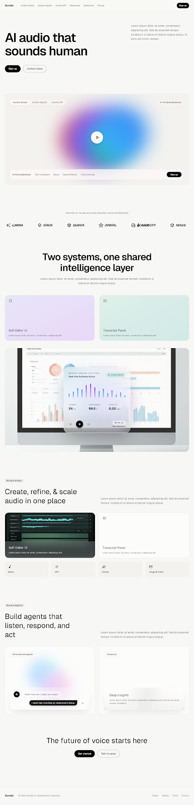

# Auralis — AI Audio That Sounds Human

A high-fidelity, enterprise-grade landing page for **Auralis AI**, built with **Tailwind CSS**, **Geist Typography**, **Web Audio API sound synthesis**, and modern glassmorphic UI architecture based on the "Engineered Softness" design system.

🔗 **Live Demo:** [https://marsbansiti.github.io/auralis-ai-saas-landing-page/](https://marsbansiti.github.io/auralis-ai-saas-landing-page/)



## Overview

Auralis is a next-generation neural speech synthesis platform engineered for both multi-track DAW post-production and sub-100ms conversational voice agents. This repository contains the complete, self-contained, and interactive SaaS landing page.

## Key Features

- **Engineered Softness Aesthetic:** Warm neutral paper canvas (`#F7F7F5`), mounted panels (`#F3F2EF`), elevated cards (`#FCFCFB`), and hairline borders (`#E7E7E4`).
- **Interactive Audio Synthesizer:** Real-time in-browser Web Audio API synthesis that plays harmonic chords and simulated voice frequencies upon clicking playback controls.
- **Hero Showcase & Ambient Gradient Orbs:** Ethereal animated mesh glows with interactive tool switcher (*AI Voice Generator*, *Text to Speech*, *Music*, *Sound Effects*, *Voice Cloning*).
- **Studio Display Workstation Mockup:** Apple Studio Display chassis with multitrack DAW visuals and a floating frosted glassmorphic **Neural Engine v4.2 PRO** widget with animated spectral equalizer bars and live latency counters.
- **Auralis Studio Module:** Dual-card DAW workflow simulator with timeline scrubbing and transcript synchronization.
- **Auralis Agents Module:** Omnichannel conversational agent simulator with real-time turn-taking latency indicators.
- **Infinite Brand Marquee:** Smooth continuous ticker featuring partner brand marks.
- **Responsive & Accessible:** Fully mobile-responsive drawer navigation with dark/light tone harmony.

## Tech Stack

- **HTML5 & CSS3**
- **Tailwind CSS** (via CDN with Forms & Container Queries plugins)
- **Geist & JetBrains Mono Fonts** (Google Fonts)
- **Material Symbols Outlined**
- **Web Audio API** (Zero-dependency client-side audio engine)

## Quick Start / Local Preview

1. **Clone the repository:**
   ```bash
   git clone https://github.com/Marsbansiti/auralis-ai-saas-landing-page.git
   cd auralis-ai-saas-landing-page
   ```

2. **Run a local server (Python):**
   ```bash
   python -m http.server 8080
   ```

3. **Or run with Node:**
   ```bash
   npx serve .
   ```

4. Open [http://localhost:8080](http://localhost:8080) in your browser.

## Project Structure

```
├── index.html           # Main production landing page
├── code.html            # Mirror source template
├── DESIGN.md            # Detailed design tokens, typography & spacing rules
├── screen.png           # Original visual design reference
└── README.md            # Project documentation
```

## License

MIT License. Designed and engineered for high-precision audio experiences.
